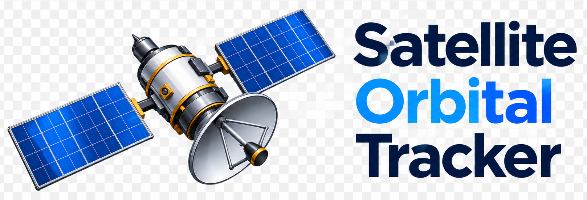

<p align="left">
  <picture>
    <source media="(prefers-color-scheme: dark)" srcset="custom_components/satellite_orbital_tracker/brand/dark_logo@2x.png">
    <source media="(prefers-color-scheme: light)" srcset="custom_components/satellite_orbital_tracker/brand/logo@2x.png">
    
  </picture>
  <br>
</p>

---

# Satellite Orbital Tracker Integration for Home Assistant

[](https://my.home-assistant.io/redirect/hacs_repository/?owner=baylanger&repository=satellite_orbital_tracker)
[](https://github.com/baylanger/satellite_orbital_tracker/stargazers)
[](https://github.com/baylanger/satellite_orbital_tracker/releases)
[](https://github.com/baylanger/satellite_orbital_tracker/releases)
[](https://github.com/baylanger/satellite_orbital_tracker/actions/workflows/test.yml)


Track the International Space Station (ISS), the Hubble Space Telescope, or any custom satellite simultaneously in Home Assistant.

This integration operates entirely locally and does not rely on external cloud APIs except for fetching, every 12hrs, public orbital element sets (TLEs) from CelesTrak. The last download is saved, so restarting Home Assistant does not download them again.

It is an advanced, high-precision custom integration for Home Assistant that tracks any satellite using real-time orbital mechanics. It uses local SGP4 orbit propagation using [Skyfield](https://rhodesmill.org/skyfield/) and your Home Assistant zone coordinates to calculate live subpoint positions and predict upcoming overhead passes.

This integration utilizes the `skyfield` library and live CelesTrak TLE (Two-Line Element) data to perform **local SGP4 propagation**, giving you institutional-grade positional accuracy entirely offline and free of cloud dependencies.

## 🤝 Contributing & Feedback

Contributions, bug reports, and suggestions are always welcome! If you have an idea to make this better or run into any issues, feel free to open an issue or submit a pull request.

---

## Features

- **Local SGP4 Tracking**: Computes position locally without relying on external cloud tracking APIs.
- **UI Config Flow**: Set up and configure satellites directly from the Home Assistant user interface.
- **Multi-Satellite Support**: Track multiple spacecraft concurrently.
- **Resilient Fallback & Caching**: Memory caches TLE data and persistent storage to handle intermittent network issues and utilizes a multi-pass lookahead engine to handle mid-pass edge cases.
- **Automatic Home Overhead Pass Detection**: Automatically calculates your upcoming local overhead passes using your Home Assistant zone coordinates (`latitude`, `longitude`, `elevation`), exposing transition times and maximum elevation attributes.
- **Automatic Satellite Identification & Naming**: Enter a NORAD ID (e.g., `25544` for the ISS), and the integration dynamically fetches the official satellite name directly from CelesTrak's GP data feed. This name is automatically used to register your device and format your sensor entity names (e.g., `Satellite ISS (Zarya)`). If you rename the entry yourself, your title is kept: the integration only follows a name change on CelesTrak while the title is still the one it set.
- **Configurable Polling Interval**: Fine-tune your update frequency between 5 and 3600 seconds directly during setup or through the options flow.
- **Multi-Language Support**: Fully localized with built-in translation dictionaries for English (`en`), French (`fr`), German (`de`), Español (`es`), Dutch (`nl`), Italian (`it`).
- **Map Optimized**: Exposes standard latitude, longitude, and elevation attributes natively compatible with Home Assistant's Map Card.
- **ISS Crew Members**: When tracking the ISS, the list of current in-space astronauts is extracted, every 24hrs, from [NASA Human In Space](https://www.nasa.gov/humans-in-space/astronauts/) and added to the sensor. If NASA can't be reached, the page returns no crew, or the page's "At the Space Station" section can't be found (for example after a NASA site redesign), the previous list is kept and the integration retries every 24hrs.

### Robust Error Handling & Repair Notifications

The integration includes built-in resilience for tracking satellite data from CelesTrak:
- **Transient Error Backoff:** If CelesTrak returns temporary server errors (5xx), rate limits you (403) or any other non-200 response, the coordinator backs off and retries on an accelerated 1-hour schedule rather than waiting for the standard 12-hour sync window. These responses are never treated as a missing satellite.
- **Lost Satellite Detection (24-Hour Grace Period):** If CelesTrak returns a continuous `404 Not Found`, or an HTTP 200 without any TLE data, for over 24 hours (indicating a decayed or decommissioned satellite), Home Assistant will automatically trigger a **Repair Issue** notification. The start of the outage is saved, so restarting Home Assistant during the outage does not restart the 24-hour count.
- **Automatic Recovery:** If the satellite shows back up in the CelesTrak database and returns a valid TLE (HTTP 200) after a 404 repair was raised, the integration automatically clears the repair issue and resets its internal tracking.
- **No Frozen Positions:** If the orbital calculation fails 5 times in a row, the sensors become unavailable instead of continuing to show the last known position.

---

## Installation

### Option 1: HACS (Recommended)

1. Ensure you have [HACS](https://hacs.xyz/) installed.
2. Open HACS in your Home Assistant dashboard and search for **Satellite Orbital Tracker**.
3. Click **Download**, then **Restart** Home Assistant.

If it does not show up in the HACS search yet, add it as a custom repository first:

1. In HACS, click the three dots in the top right corner and select **Custom repositories**.
2. Paste the repository URL (`https://github.com/baylanger/satellite_orbital_tracker`) and select **Integration** as the category.
3. Click **Add**, then find **Satellite Orbital Tracker** in the list, click **Download**, and **Restart** Home Assistant.

### Option 2: Manual Installation

1. Download the [latest release ZIP file](https://github.com/baylanger/satellite_orbital_tracker/releases/latest) or clone this repository.
2. Copy the `custom_components/satellite_orbital_tracker` folder into your Home Assistant configuration directory (`/config/custom_components/`).
3. **Restart** Home Assistant to complete the setup.

---

## Configuration

In Home Assistant,
1. Go to **Settings -> Devices & Services**
2. Click **Add Integration** in the bottom right.
3. Search for **Satellite Orbital Tracker**
4. Configure satellite tracking parameters:

| Parameter | Type | Default | Description |
| :--- | :--- | :--- | :--- |
| **NORAD ID** | String | *Required* | The catalog number of the satellite (e.g., `25544`), digits only. Leading zeros are ignored (`025544` is the same satellite as `25544`). Used to query CelesTrak and compute orbital paths. |
| **Update Interval** | Number | `120` | How often (in seconds) the sensor data and coordinates refresh (bounded between 5 and 3600 seconds). While a satellite is above 10° over your home (a pass in progress), it refreshes every 5 seconds instead. |

5. Click **Submit**.

### Managing Options
You can later adjust the polling update interval at any time by clicking the **Configure** (gear) button on the integration entry in your UI.

### Removing a Satellite
Deleting a satellite's entry also deletes its saved TLE cache and any repair notification for it.

### Finding Satellite Catalog Numbers (`norad_id`)
You can look up the unique NORAD Catalog Number (CATNR) for any spacecraft using the [CelesTrak Satellite Catalog (SATCAT)](https://celestrak.org/satcat/search.php).

* **Popular Presets:**
  * **ISS (Zarya):** `25544` (International Space Station)
  * **Hubble Space Telescope:** `20580`
  * **CSS (Tianhe):** `48274` (Chinese Space Station)

---

## Generated Sensors & Naming Convention

Each satellite instance creates a dedicated device with thirteen namespaced entities to prevent ID collisions when tracking multiple spacecraft:

1. Status Sensor
Entity ID Pattern: `sensor.satellite_[name]_status` (e.g., `sensor.satellite_iss_zarya_status`)
State: Current operational tracking state:
  - `Overhead Now!`: The satellite is currently above 10° elevation from your home coordinates (from its rise until its set).
  - `Approaching (...)`: The next pass event (rise) happens within 15 minutes.
  - `In Orbit`: Any other time.
Attributes:
  - `latitude`, `longitude` : Live coordinates
  - `next_pass_event` : The phase of the pass (Rise (Above 10°), Culmination (Highest Point), or Set
    - Rise (Above 10°): The satellite crosses above your 10° horizon threshold. It enters your visible sky.
    - Culmination (Highest Point): The satellite reaches its peak elevation angle in the sky directly above (or closest to) your home coordinates.
    - Set: The satellite dips back below the 10° threshold, ending the visible pass.
  - `tle_epoch` : ISO8601 timestamp of the orbital elements (TLE) currently used for the calculations
  - `tle_last_fetched` : ISO8601 timestamp of when those orbital elements were last downloaded from CelesTrak
  - `source` : Tracking engine identifier (Local SGP4 Engine)

2. Orbital Altitude Sensor
Entity ID Pattern: `sensor.satellite_[name]_orbital_altitude`
State: Physical orbital height above the Earth's geoid.
Disabled by default on new installs (it changes with every update): enable it under Settings > Devices & services > the satellite's device. Existing installs keep it enabled.
Unit of Measurement: km
State Class: measurement

3. Next Pass Max Elevation Sensor
Entity ID Pattern: `sensor.satellite_[name]_next_pass_max_elevation`
State: Peak sky elevation angle for the next upcoming overhead pass. While a pass is in progress, it shows the peak of that pass until the satellite sets.
Unit of Measurement: °
State Class: measurement

4. Next Pass Time Sensor
Entity ID Pattern: `sensor.satellite_[name]_next_pass_time`
State: Date and time of the next upcoming pass over your home coordinates (a timestamp, displayed in your Home Assistant time zone).
Device Class: timestamp

5. Next Pass Time Remaining Sensor
Entity ID Pattern: `sensor.satellite_[name]_next_pass_time_remaining`
State: Seconds until the next upcoming pass event, handy for automations that prepare for a pass.
Unit of Measurement: s
Device Class: duration
State Class: measurement

6. Pass Duration Sensor
Entity ID Pattern: `sensor.satellite_[name]_pass_duration`
State: Length in seconds of the pass in progress (from its rise above 10° until its set), or of the next pass if none is in progress. Unknown if the pass has no known end.
Attributes:
  - `pass_start`, `pass_end` : ISO8601 timestamps (UTC) of that pass's rise and set
Unit of Measurement: s
Device Class: duration

7. Pass Time Remaining Sensor
Entity ID Pattern: `sensor.satellite_[name]_pass_time_remaining`
State: Seconds left until the satellite sets, while it is overhead (`Overhead Now!`). `0` when no pass is in progress. Unknown in the rare case that a pass is under way but its end is not known.
Unit of Measurement: s
Device Class: duration

Not to be confused with *Next Pass Time Remaining*, which counts down to the next rise, peak or set. While a pass is in progress both are refreshed every 5 seconds (the update that detects the rise is timed to it, so the pass is picked up when it starts, not up to one polling interval later). Outside a pass they follow your polling interval (default 120 s). Pass Time Remaining changes every 5 seconds during a pass, so exclude it from the recorder if you don't want that history. Status (with its position attributes) also changes every update; Orbital Altitude and Orbital Speed do too, but they are disabled by default.

8. Orbital Speed Sensor
Entity ID Pattern: `sensor.satellite_[name]_orbital_speed`
State: How fast the satellite is moving along its orbit, taken from the velocity of the orbital model (about 27,600 km/h for the ISS), measured relative to the centre of the Earth. It is not the speed of the point on the ground below the satellite, which is lower because the Earth turns underneath. Home Assistant shows it in mph if your unit system is imperial.
Disabled by default (for the ISS it stays within a few km/h of the same value): enable it under Settings > Devices & services > the satellite's device.
Attributes:
  - `speed_km_s` : The same speed in km/s
Unit of Measurement: km/h
Device Class: speed
State Class: measurement

9. Sunlit Binary Sensor
Entity ID Pattern: `binary_sensor.satellite_[name]_sunlit`
State: `on` while the Sun shines on the satellite, `off` while it is in the Earth's shadow. A satellite is much easier to see from the ground when it is sunlit and the sky above you is dark.
Device Class: light

10. Next Satellite Sunrise Sensor
Entity ID Pattern: `sensor.satellite_[name]_next_satellite_sunrise`
State: The next time the satellite comes out of the Earth's shadow and the Sun starts to shine on it (a timestamp, displayed in your Home Assistant time zone). Unknown if there is none in the next 24 hours.
Device Class: timestamp

11. Next Satellite Sunset Sensor
Entity ID Pattern: `sensor.satellite_[name]_next_satellite_sunset`
State: The next time the satellite enters the Earth's shadow. Unknown if there is none in the next 24 hours (the ISS has periods of several days when it stays in the sunlight).
Device Class: timestamp

12. Visible Now Binary Sensor
Entity ID Pattern: `binary_sensor.satellite_[name]_visible_now`
State: `on` while all three are true: the satellite is above 10° over your home (a pass in progress), the Sun shines on it (Sunlit), and the sky at your home location is dark, meaning the Sun is 6° or more below your horizon (the end of civil twilight; the exact limit counts as dark). Unknown if one of these can't be worked out.
Attributes:
  - `sun_elevation_at_home` : The Sun's height above your horizon, in degrees (negative at night)
  - `dark_below_sun_elevation` : The limit used, -6°
  - `satellite_sunlit`, `status` : The other two things the answer depends on
The Sun's elevation at your home is computed inside the integration from the Home Assistant home location. It is not read from Home Assistant's own Sun integration, which gives sunrise and sunset for today only and not the Sun's height at the time of a future pass.

13. Next Visible Pass Sensor
Entity ID Pattern: `sensor.satellite_[name]_next_visible_pass`
State: When the next pass becomes visible from your home (a timestamp, displayed in your Home Assistant time zone): the satellite is above 10°, the Sun shines on it, and the Sun is 6° or more below your horizon, the same three conditions as Visible Now. Unknown if there is none in the next 7 days. A visible pass already under way is not shown; the sensor looks at the next one.
Attributes:
  - `visible_end` : When it stops being visible (it sets, or enters the Earth's shadow), ISO8601 UTC
  - `duration` : Length of the visible part, in seconds
  - `max_elevation`, `max_elevation_time` : Highest point of the visible part and when it happens
  - `start_azimuth`, `start_direction` : Where to look when it appears: degrees clockwise from north, and the compass point (N, NNE, NE ...)
  - `end_azimuth`, `end_direction` : Where it disappears
  - `pass_start`, `pass_end` : The whole pass above 10°, which may be longer than the visible part
Predictions several days ahead are estimates: they are recomputed with every new TLE download, and the closer the pass, the more exact they are. Use the state in a time trigger (with an offset to get a warning before the pass), and Visible Now to know when it is happening.

Visible Now (12) is enabled when a satellite is added. The other sunlight and visibility entities (9 to 11 and 13) are **disabled by default**. Enable the ones you want under Settings > Devices & services > the satellite's device. The Sun's direction is computed inside the integration, so nothing is downloaded. The Earth's shadow is treated as a sharp-edged cylinder, so the times are good to a few seconds. They do not depend on where you are: "sunrise" here is the satellite's own, not yours.

---

## Recommended Map Card Setup

To keep the map cleanly zoomed out on a global view and display the historical trail of the ISS with timestamps, add a Manual card to your dashboard using the following YAML configuration:

```yaml
type: map
auto_fit: false
default_zoom: 2
hours_to_show: 3.5
entities:
  - entity: sensor.satellite_iss_zarya_status
    name: ISS
    focus: true
    label_mode: icon
theme_mode: auto
```
Map Options Explained:
- `auto_fit: false`: Prevents the map from aggressively resetting or jumping focus every time coordinates update.
- `default_zoom: 2`: Keeps the map view zoomed out globally across the planet.
- `hours_to_show: 3.5`: Plots a trailing history line on the map so you can hover over previous points to see timestamps and direction of travel.
- `focus: true`: Keeps this entity in view when the map moves and zooms to show your entities.
- `theme_mode: auto`: Automatically adjusts to match your dashboard's light or dark theme mode.

## Recommended Astronauts Crew Members on ISS Card Setup

Adjust the entity IDs (the two `sensor.satellite_iss_zarya_...` names) if yours are different: see **Developer Tools -> States**.

```yaml
type: markdown
title: 🛰️ ISS (Zarya) Status & Crew
content: |
  
  
  Next Pass: {{ state_attr(st, 'next_pass_event') or 'n/a' }} at {{ nxt | as_timestamp | timestamp_custom('%Y-%m-%d %H:%M') }}

  ---

  ### Crew Members ({{ state_attr(st, 'crew_count') or 0 }})
  
  * **{{ member.name }}** ({{ member.agency }})
  
    * {{ part }}
  
  
grid_options:
  rows: 10
  columns: 15
```

---

## Public orbital element sets (TLEs)

For each satellite, the integration fetches the public orbital element sets (TLEs) every 12 hours. The last download is saved: at startup, or when the integration reloads after an options change, the saved TLEs are reused while they are less than 12 hours old, and fetched right away when they are older (or when none were saved yet).

- Why 12 Hours?
Orbital Drift: Satellites experience constant perturbations from atmospheric drag, Earth's non-uniform gravity field, and solar radiation pressure. Over time, predicting positions too far into the future using stale TLEs introduces increasing error.
- CelesTrak Updates: CelesTrak updates General Perturbations (GP) elements multiple times daily for active satellites. Refreshing every 12 hours strikes an ideal balance—it keeps your local SGP4 propagation accurate and up-to-date without spamming external servers or hitting rate limits.
- Resilient Caching: If CelesTrak experiences a brief downtime or network error during a scheduled 12-hour refresh, the coordinator falls back to your currently cached TLE data rather than crashing the sensor states.

---

## Running the tests (lint & pytest)

The tests use [pytest-homeassistant-custom-component](https://github.com/MatthewFlamm/pytest-homeassistant-custom-component), which needs a recent Python (CI runs 3.13 and 3.14).

```bash
git clone git@github.com:baylanger/satellite_orbital_tracker.git
cd satellite_orbital_tracker

python -m venv .venv
source .venv/bin/activate
pip install -r requirements_test.txt

ruff check --select F custom_components tests
pytest
```

With a coverage report (same as CI):

```bash
pytest --cov=custom_components.satellite_orbital_tracker --cov-report=term-missing
```

Run a single file or test:

```bash
pytest tests/test_config_flow.py
pytest tests/test_config_flow.py::test_form_user
```

The tests never contact CelesTrak or NASA; all network calls are mocked.

---

## License
This project is licensed under the MIT License. See the LICENSE file for details.
